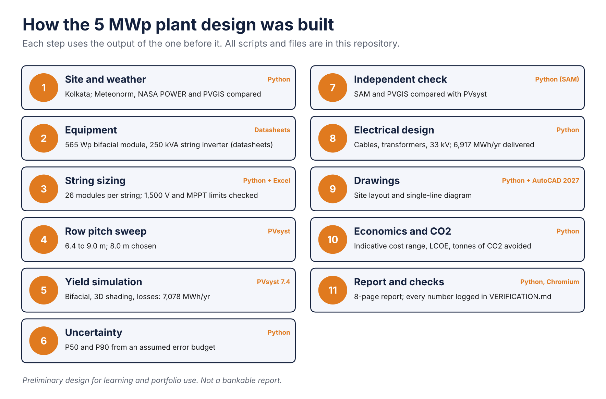
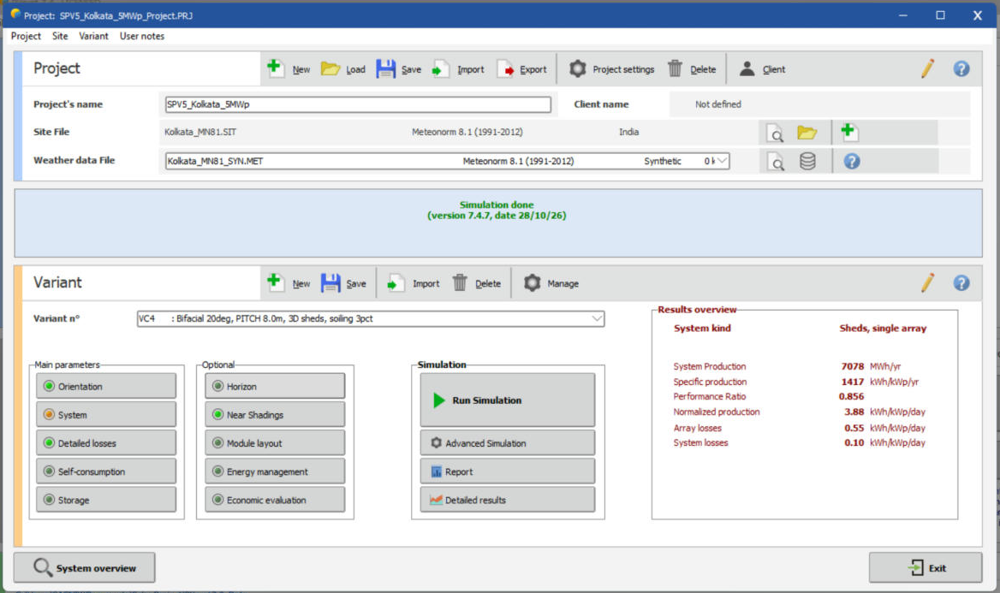
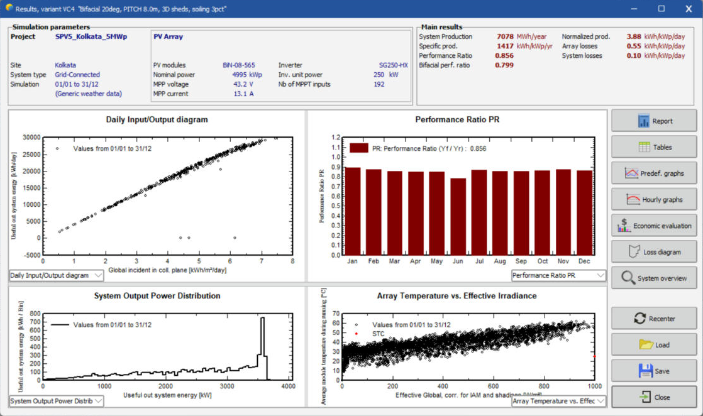
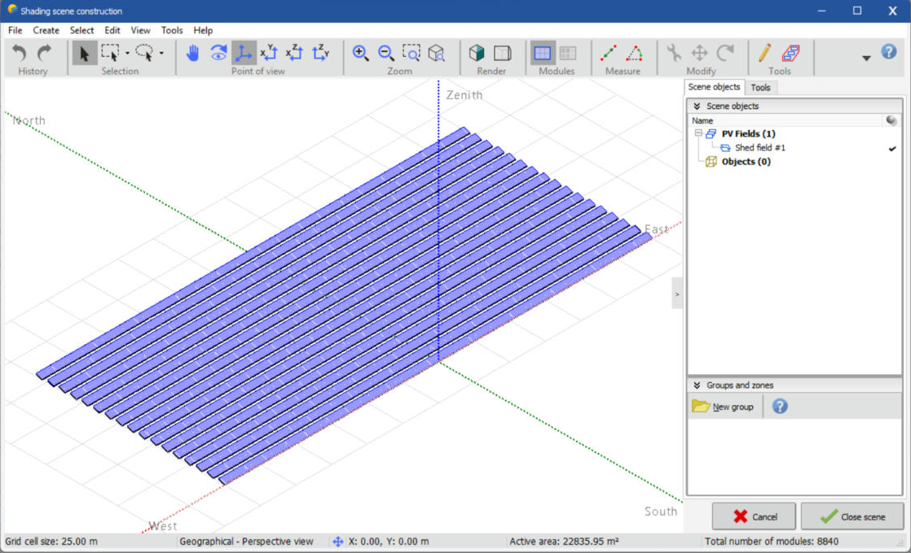
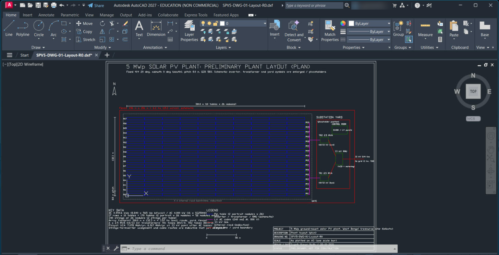

# 5 MWp Solar Power Plant: Design and Energy Yield Study (Kolkata, West Bengal)


*AI-generated illustration (ChatGPT) for decoration. All charts, drawings and numbers below come from this project's own calculations and PVsyst.*

## What is this project, in plain words?

A solar power plant turns sunlight into electricity. Before anyone builds one, engineers have to answer: *how many panels, how should they be wired, how far apart should the rows be, and how much electricity will it really produce in a year?*

This project answers those questions for a **5 megawatt solar plant using Kolkata's climate**. It is a **student design study**, not a plant that was built or bid for. I worked through the full chain a solar design team follows: weather data, equipment choice, wiring, a one-year energy simulation, an independent cross-check, electrical design, drawings and a rough cost estimate.

**The answer in one line:** 8,840 panels would deliver about **6,900 MWh of electricity per year**, and avoid about **5,000 tonnes of CO₂ a year**.

**New here? Start with the illustrated [step-by-step walkthrough](docs/WALKTHROUGH.md).**



## Proof of work: real software screenshots

The banner above is an AI-generated illustration. The four images below are **screenshots taken on 28 Oct 2026 from the actual software** used for this project (the project files are in this repo, so you can open them yourself).

**PVsyst 7.4: project window, final design (variant VC4)**: 7,078 MWh/yr, 1,417 kWh/kWp/yr, PR 0.856.


**PVsyst 7.4: results dashboard (VC4)**: BiN-08-565 modules, SG250-HX inverters, 4,995 kWp, 192 MPPT inputs, monthly PR. (The dip in June is a random unavailability period in the simulation; the annual total is unaffected.)


**PVsyst 7.4: 3D shading scene**: 17 rows, 8,840 modules, 22,836 m² active area.


**AutoCAD 2027 (Autodesk Education licence): the plant layout drawing.** The title bar reads "EDUCATION (NON COMMERCIAL)". The drawing geometry was generated with a Python script, then opened and saved as DWG in AutoCAD. My account name is blurred.


**Author:** Sagnik Kumar Nath, B.Tech Electrical Engineering, IEM Kolkata (2027)

> **Status:** complete as a preliminary design (target date 30 Nov 2026). Open items: plot and substation choice, confirming the module's ALMM/DCR listing, and a practising engineer's review. Every limitation is listed under [Limitations](#limitations).

---

## Key results

| Parameter | Value |
|---|---|
| Site (resource location) | Kolkata, 22.57 °N, 88.36 °E (exact plot TBD) |
| Land area | TBD |
| DC capacity / AC capacity | 4,994.6 kWp / 4,000 kW (nominal, derates in heat) |
| DC/AC ratio | 1.249 |
| Module | Waaree ELITE BiN-08-565, N-type TOPCon bifacial (ALMM/DCR status to be verified) |
| Inverter | 16 × Sungrow SG250HX (1500 V string inverter) |
| Modules per string / no. of strings | 26 / 340 (8,840 modules) |
| Tilt / azimuth / row pitch | 20° / 0° (south) / 8.0 m (GCR 58%), chosen from a 4-pitch sweep |
| Annual GHI | 1,574 (Meteonorm 8.1, used in PVsyst) / 1,669 (NASA POWER) / 1,730 (PVGIS) kWh/m²/yr |
| Energy, PVsyst VC4 (bifacial, 3D shading, losses; preliminary) | 7,078 MWh/yr |
| P50 energy yield | 7,078 MWh/yr (preliminary) |
| P90 energy yield (1-year) | 6,458 MWh/yr (assumed uncertainty budget) |
| Specific yield | 1,417 kWh/kWp/yr |
| Performance ratio | 85.6% (bifacial gain of about 4.4% offsets shading, soiling and availability) |
| Cross-check vs SAM / PVGIS | PVsyst is 4.6% / 6.6% below SAM / PVGIS as run; within 0.9% of SAM once scaled to Meteonorm irradiance (see `calcs/output/crosscheck_sam_pvgis.md`) |
| Energy at 33 kV point | 6,917 MWh/yr (after 2.28% AC-side losses, `calcs/output/cable_sizing.md`) |
| Capex / LCOE (indicative) | ₹3.5 to 4.4 crore/MWp, LCOE ₹3.5 to 4.3/kWh. Capex cross-checked against the CTUIL benchmark (₹3.5 cr/MW); see `calcs/output/economics.md` and `VERIFICATION.md` |
| CO₂ avoided | about 5,030 t/yr (CEA average factor 0.727 t/MWh) |

---

## Approach

1. **Site and resource:** site selection and justification, plus irradiance from Meteonorm cross-checked against PVGIS and NASA POWER. → [`data/`](data/)
2. **Equipment selection:** an ALMM-listed module and an inverter, with reasoning on DCR/ALMM and string vs central inverters and the DC/AC ratio. → [`data/datasheets/`](data/datasheets/)
3. **Array and string design:** tilt, row pitch, and string sizing (Voc at record minimum temperature, Vmp within the MPPT window, current limits). → [`calcs/`](calcs/)
4. **Energy simulation:** PVsyst with a 3D near-shading scene, loss diagram, PR, and P50/P90. → [`pvsyst/`](pvsyst/)
5. **Cross-checks:** NREL SAM and PVGIS, with any difference above 3% explained.
6. **Electrical sizing:** DC and AC cables (voltage drop, ampacity, derating), DCDB/ACDB, inverter transformer, and the 33 kV evacuation concept.
7. **Drawings:** plant layout and single-line diagram, generated in Python and saved as DWG in AutoCAD. → [`drawings/`](drawings/)
8. **BOQ and economics:** capex, LCOE, payback and CO₂ avoided.
9. **Report:** → [`report/`](report/)

Every design assumption, with its value, source and reason, is logged in **[ASSUMPTIONS.md](ASSUMPTIONS.md)**.

## Repository structure

```
data/          site info, weather data comparison, equipment datasheets
calcs/         string sizing (Python + Excel), later cable sizing & economics
pvsyst/        PVsyst project files, exported reports, screenshots
drawings/      layout and single-line diagram (DWG, DXF, PDF, PNG)
report/        draft PDF report (report.html is its source), interview Q&A drafts
linkedin/      LinkedIn Projects entry, post draft, CV bullets
showcase/      images and PDFs meant for public posting
ASSUMPTIONS.md assumption log (value, source, reason)
PLAN.md        4-week work plan and checklist
```

## Tools

PVsyst (IEM academic licence), NREL SAM, PVGIS, NASA POWER, Python (including `ezdxf` for drawings), AutoCAD 2027 (Autodesk Education licence, used to open and save the DWG files), Excel.

## Run the calculations

```bash
python calcs/fetch_weather.py --lat 22.57 --lon 88.36    # PVGIS + NASA POWER data
python calcs/weather_compare.py                          # irradiance cross-check
python calcs/string_sizing.py                            # uses calcs/config/design_inputs.json
python calcs/string_sizing.py --config calcs/config/example_inputs.json   # worked example
python calcs/cable_sizing.py                            # cable sizing and AC-side losses
python calcs/economics.py                               # BOQ scope, capex, LCOE, CO2 (needs cable_sizing first)
python calcs/make_drawings.py                           # layout and SLD (needs ezdxf, matplotlib)
python calcs/make_report.py                             # report/report.html to PDF (needs Playwright)
python -m unittest discover calcs/tests
```

The string sizing needs only the Python 3 standard library; the cross-check scripts need PySAM and requests, and the report build needs Playwright (the Excel version, `calcs/string_sizing.xlsx`, mirrors the script).

## Limitations

- Preliminary design: no topographic survey, soil or flood data, and no DISCOM feasibility. The plot, land area and 33 kV substation are not fixed.
- P50/P90 uses an assumed uncertainty budget, not measured values.
- Costs are indicative: capex agrees with the CTUIL benchmark, but LCOE is not comparable with large-project auction tariffs; quote costs only as a range.
- Module-string shading and monthly soiling are not modelled; PVsyst warns about unequal MPPT string counts.
- Module ALMM/DCR status of the exact model is not confirmed (datasheet values are verified).
- PVsyst is used under an academic licence.
- Drawings are schematic (symbols enlarged, yard and 33 kV route are placeholders) and not checked by a practising engineer.

## Verification and FAQ
- `VERIFICATION.md`: each key number, its source, and whether it is verified, assumed or open.
- `FAQ.md`: short answers about scope and limits.
