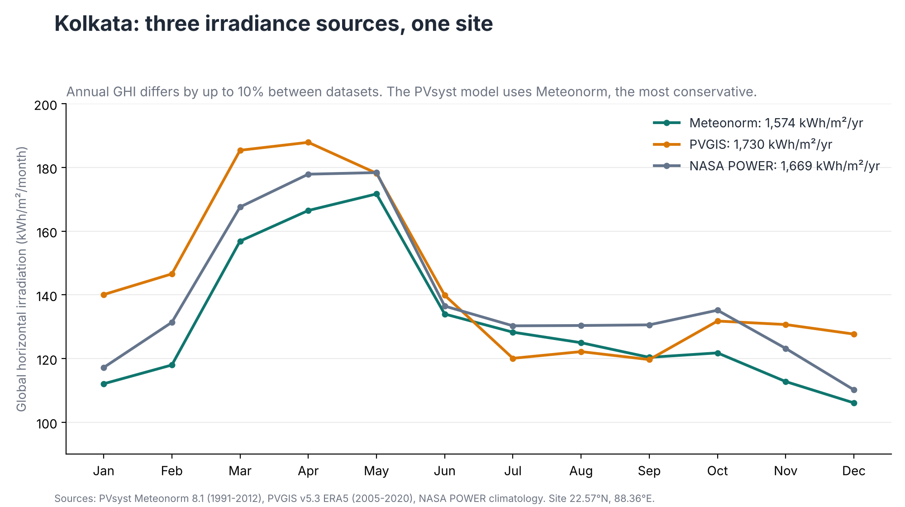
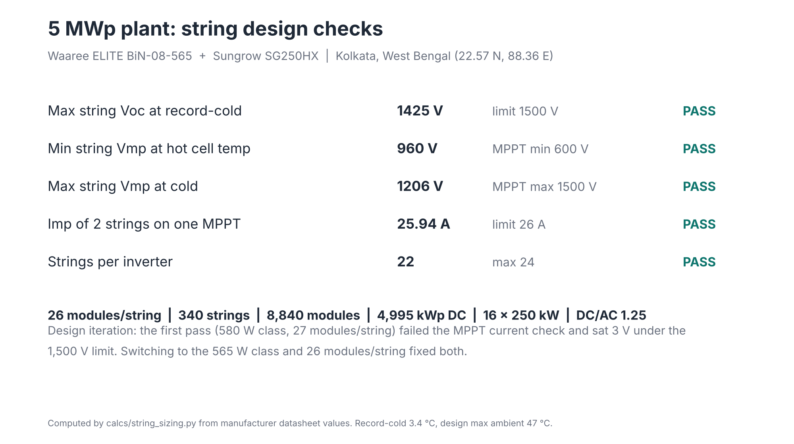
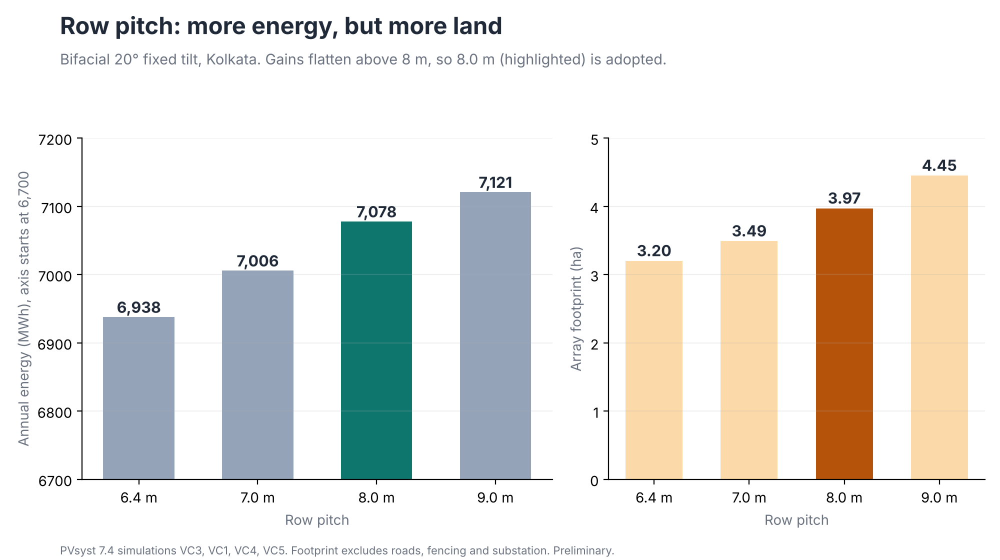
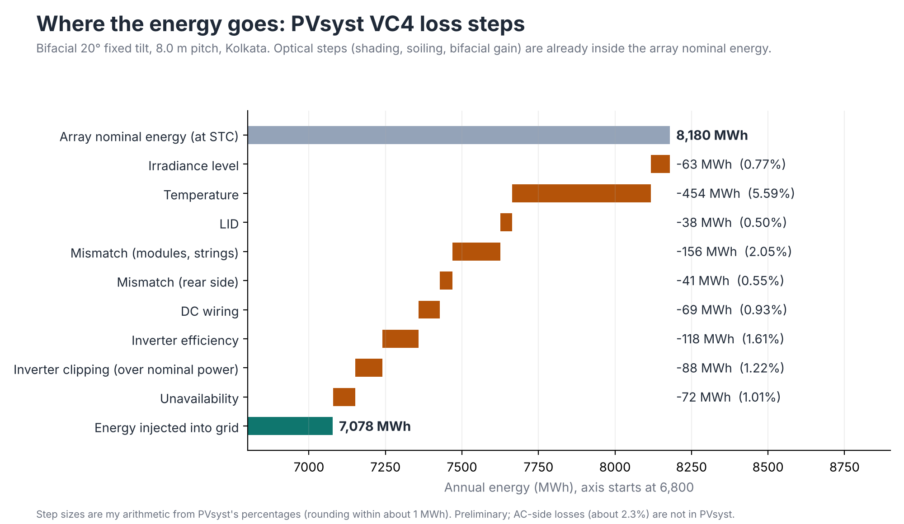
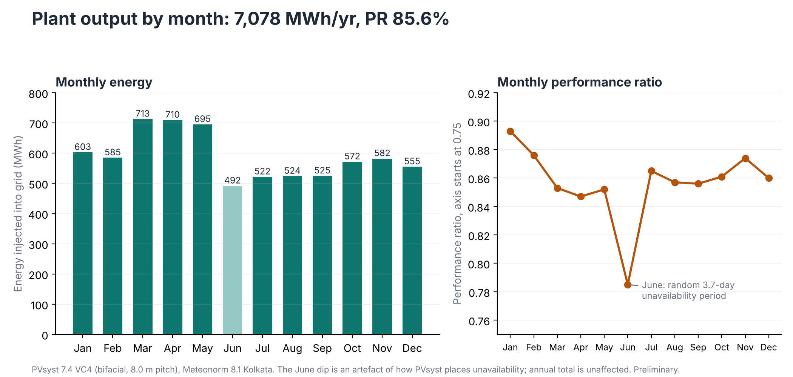
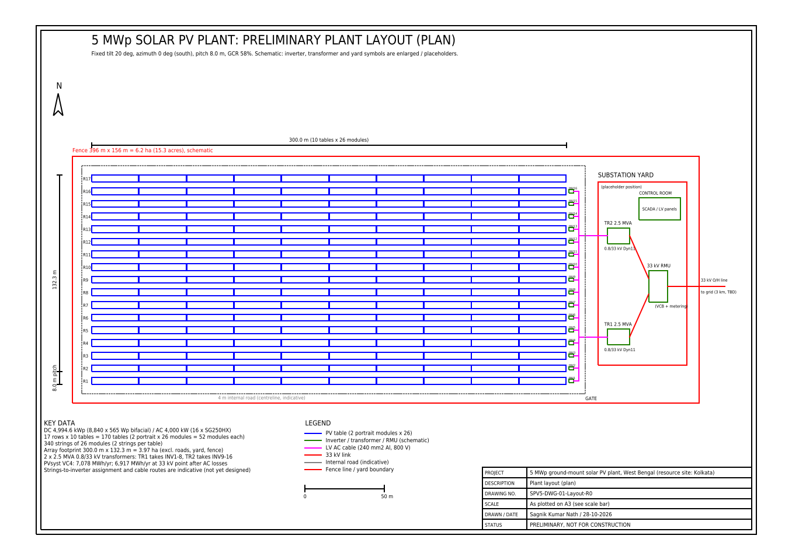
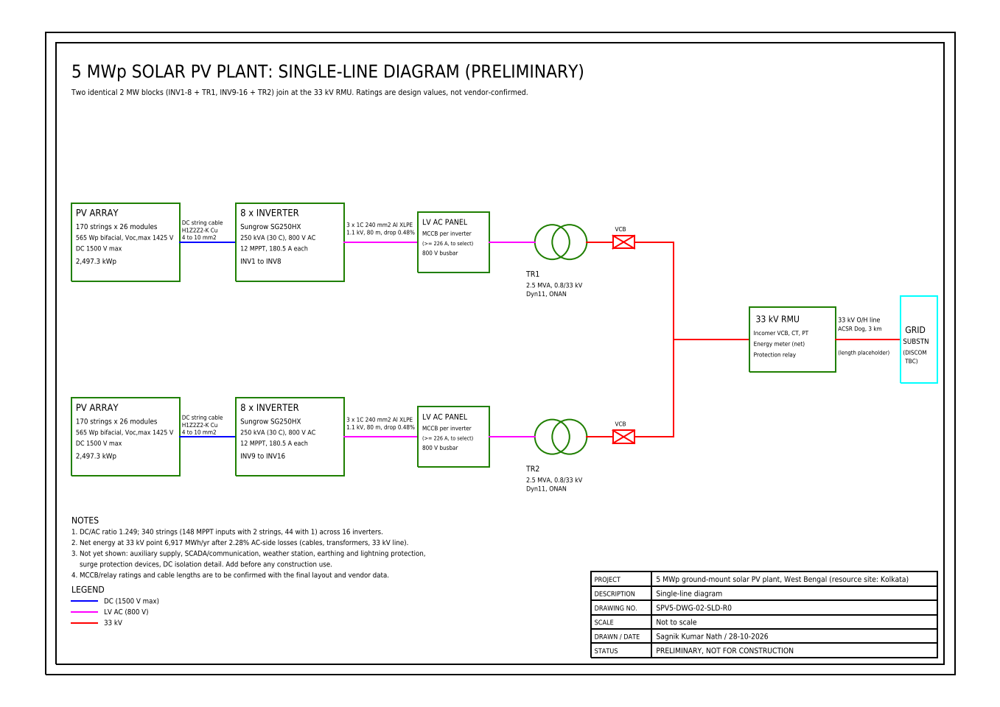

# How this 5 MWp solar plant design was built, step by step

This page explains the whole project in plain language, in the order the work was done. You do not need to know solar engineering to follow it. Every claim points to a file in this repository, so you can check it.

*AI-generated illustration (ChatGPT), for decoration only.*

**What is this?** A preliminary design of a 5 MWp ground-mounted solar power plant, using Kolkata's climate, to learn and demonstrate the full design chain: weather, equipment, layout, energy simulation, electrical design, drawings and economics. It is a student project, not a built or bid plant. Nothing here replaces a site survey or a bankable report.

**Tools used:** Python (calculations, charts, drawings, report), PVsyst 7.4 (energy simulation), AutoCAD 2027 (opened the Python-generated drawing files and saved them as DWG), Excel (string-sizing workbook), SAM and PVGIS (independent cross-check).

---

## Step 1. Pick the site and the weather data

A solar plant's output depends on how much sunlight reaches it, so everything starts with weather data. I used Kolkata (West Bengal) and compared three public sources of sunlight data: Meteonorm, NASA POWER and PVGIS. They disagree by up to about 10% (1,574 to 1,730 kWh/m² per year). I used the lowest, Meteonorm, to stay on the cautious side.

Files: `data/site.md`, `calcs/weather_compare.py`, `calcs/output/weather_comparison.md`.

## Step 2. Choose the equipment

- **Module:** Waaree ELITE BiN-08-565, a 565 Wp bifacial (collects light on both faces) module.
- **Inverter:** Sungrow SG250HX, a 250 kVA string inverter with 12 inputs.

The electrical values used in the calculations were checked against the manufacturers' datasheets (see `VERIFICATION.md`).

## Step 3. Decide how many modules go in each string

Modules are wired in series into strings. Too few, and the inverter's voltage is too low on a hot day. Too many, and the voltage on the coldest morning can exceed the 1,500 V limit. I calculated the voltage at the record-low and record-high temperatures and found 26 modules per string is the number that stays inside both limits (1,425 V coldest, 960 V hottest).

Result: 340 strings × 26 modules = 8,840 modules = 4,994.6 kWp, on 16 inverters (4 MW AC). Files: `calcs/string_sizing.py`, `calcs/output/string_sizing_design_inputs.md`.

## Step 4. Choose the spacing between rows

Rows of panels shade each other when the sun is low. Spacing them further apart gives more energy but needs more land. I simulated pitches from 6.4 m to 9.0 m. Going from 7.0 m to 8.0 m adds 1.0% energy for 14% more land; going from 8.0 m to 9.0 m adds only 0.6% for 12% more land. I chose **8.0 m**.

Files: `calcs/pitch_sweep.py`, `calcs/output/pitch_sweep.md`.

## Step 5. Simulate a year of energy in PVsyst

PVsyst models the plant hour by hour for a year: sunlight on the tilted panels, light reflected onto the back of the bifacial modules, shading from neighbouring rows (a 3D scene of the 17 rows), temperature, dirt, wiring and inverter losses.

*Real screenshot of the 3D shading scene in PVsyst 7.4 (8,840 modules).*

*Real screenshot of the PVsyst results dashboard for the chosen design.*

Result for the chosen design: **7,078 MWh per year**, 1,417 kWh per kWp, performance ratio 85.6%. The bifacial gain is about +4.4%.

(The dip in June in the monthly chart comes from random unavailability periods in the simulation; the annual total is unaffected.)

Files: `PVsyst7.0_Data/`, `showcase/pvsyst_report_VC4_pitch8m_PRELIMINARY.pdf`.

## Step 6. Say how sure we are (P50 and P90)

A simulation gives one number, but real years vary. P50 is the yield expected to be met half the time; P90 is the yield expected to be met nine years in ten. I combined seven uncertainty sources (data source, yearly weather variation, model errors and so on) into 6.84%, giving a P90 of **6,458 MWh per year**. The uncertainty values are my assumptions, not measurements.

Files: `calcs/p50_p90.py`, `calcs/output/p50_p90.md`.

## Step 7. Check the answer independently

I re-ran the plant in SAM and compared it with PVGIS's own estimate. As first run, PVsyst's monofacial result came out 4.6% and 6.6% below them, mainly because they use different sunlight data; once SAM uses the same irradiance, the two agree within 0.9%.

Files: `calcs/crosscheck_sam.py`, `calcs/output/crosscheck_sam_pvgis.md`.

## Step 8. Design the electrical connection

PVsyst simulates the DC side and the inverters. I added the AC side by calculation: cable sizes, two 2.5 MVA transformers (0.8 kV to 33 kV) and a 33 kV switchgear unit. These losses (161 MWh, 2.28%) bring the energy delivered at the 33 kV point to **6,917 MWh per year**.

Files: `calcs/cable_sizing.py`, `calcs/output/cable_sizing.md`.

## Step 9. Draw the plant

A site layout and a single-line diagram (the electrical "map" of the plant). The drawing geometry was generated by a Python script so every dimension comes from the design numbers. I opened the resulting DXF files in **AutoCAD 2027** (education licence) and saved them as DWG files; the PDF and PNG versions come from the Python script. The drawings are schematic, not construction drawings.

*Real screenshot: the layout drawing open in AutoCAD 2027 (Education licence).*

Files: `drawings/` (DWG, DXF, PDF, PNG), `calcs/make_drawings.py`.

## Step 10. Estimate cost and carbon savings

Cost is an indicative range, not a quote: ₹3.5 to 5.5 crore per MWp, with a base case of ₹4.4. The low end matches the CTUIL benchmark of ₹3.5 crore/MW; a real 1 GW project works out near ₹5.5. About 5,030 tonnes of CO₂ are avoided in year 1 using the CEA grid emission factor.

Files: `calcs/economics.py`, `calcs/output/economics.md`.

## Step 11. Write it up and check it

An 8-page report (`report/`), a log of every key number and how it was verified (`VERIFICATION.md`), a list of every assumption (`ASSUMPTIONS.md`) and a FAQ (`FAQ.md`).

---

## What this project does not claim
- No site survey, soil, flood or grid study; the plot and substation location are not chosen.
- P50/P90 rests on assumed uncertainty values.
- Costs are indicative; LCOE is not comparable with large-project auction tariffs.
- Module-string shading and monthly soiling are not modelled.
- The module's ALMM/DCR listing for this exact model is not confirmed.
- Drawings are schematic and not reviewed by a practising engineer.
